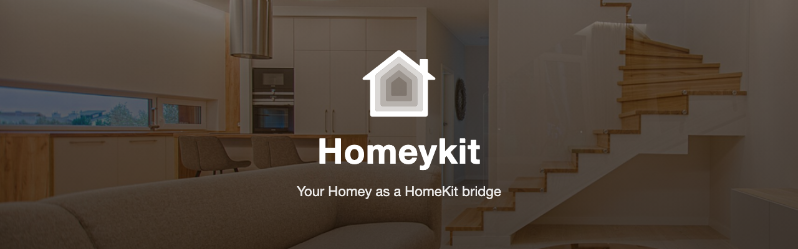

  

# Homeykit

Homeykit makes your Homey devices available in Apple HomeKit. It runs a HomeKit bridge inside your Homey, so the
devices you choose show up in the Home app on your iPhone, iPad and Mac, and you can control them with Siri,
widgets and HomeKit automations.

Everything runs on your Homey and your local network. Nothing is sent to the cloud.

## What you get

- Choose which Homey devices appear in HomeKit, with search and filters.
- Changes in the Home app reach Homey straight away, and changes in Homey show up in HomeKit within a few seconds.
- Pair once with a QR code. Your rooms and automations in the Home app keep working when you change your selection.
- Set the name of the bridge, your own pairing code and an optional startup delay.
- If the IP address of your Homey changes, the bridge restarts by itself on the new address and stays paired.
- The settings are available in English and Dutch.

## Supported devices

| Device | What works in HomeKit |
|---|---|
| Lights | On and off, dimming and colour temperature |
| Sockets and switches | On and off |
| Sensors | Temperature, humidity, motion, contact (doors and windows) and water leak |

Other device types, such as thermostats, TVs, speakers and buttons, are not supported yet. They are shown as
"Not supported" in the device list.

## Requirements

- A Homey Pro running Homey version 13 or later.
- An iPhone, iPad or Mac with the Home app, on the same network as your Homey.
- For control away from home: a home hub in your Home app (an Apple TV or HomePod).

## Getting started

1. Install Homeykit on your Homey.
2. Open the settings of the app. The first page shows a QR code and a pairing code.
3. In the Home app on your iPhone tap **+**, choose **Add Accessory** and scan the QR code. You can also choose
   **More options** and enter the code.
4. Back in the app settings, open **Devices** and switch on the devices that should be visible in HomeKit.

## Settings

- **Devices**: choose which devices are visible in HomeKit. You can search and filter on active, inactive and
  not supported devices.
- **Name**: change the name of the bridge, or restore the default name (the name of your Homey). A new name
  restarts the bridge briefly.
- **Pincode**: the pairing code is chosen randomly the first time and stays the same afterwards. You can set
  your own code or generate a new random one. Existing pairings keep working.
- **Startup**: wait a number of seconds after the app starts before the bridge starts, so Homey can load all
  devices first. This is off by default.

## Good to know

- The Home app only offers pairing while the bridge is not paired. To pair again, first remove the bridge from
  the Home app.
- If you remove the app from Homey, the pairing and your selection are removed as well, and you need to pair
  again.

## Troubleshooting

**A device shows "No Response" in the Home app**
- Check that your Homey and your iPhone are on the same network, and that the Homey is reachable.
- Restart the Homeykit app on your Homey. The bridge starts again and HomeKit reconnects.
- Make sure the router does not block local discovery between devices (mDNS) or port 51827.

**The bridge does not appear when pairing**
- Check that the bridge is not already paired: remove it from the Home app first.
- Open the settings page. If it says the bridge has not started yet, a startup delay may be set; wait for it to
  finish or turn the delay off.

**A new device is missing in HomeKit**
- Open **Devices** in the app settings and switch the device on. Devices of an unsupported type cannot be
  switched on.

Still stuck? Open an [issue](../../issues) with the version of the app and what you see. Please leave out
personal data such as device names and addresses.

## Contributing

Bug reports, ideas and pull requests are welcome. Read [CONTRIBUTING.md](CONTRIBUTING.md) first. Security
problems go through [SECURITY.md](SECURITY.md).

## How this was made

Homeykit was built with the help of AI. Most of the code, the tests and the documentation were written by
[Claude](https://www.anthropic.com/claude), an AI assistant from Anthropic, working under the direction of the
maintainer. The maintainer decides what goes in, reviews the changes and is responsible for the result. The tests
and the pipelines in this repository are there to check the work, whoever wrote it.

## Trademarks

Apple and HomeKit are trademarks of Apple Inc. Homeykit is an independent project and is not affiliated with or
endorsed by Apple.

## License

Homeykit is released under the [MIT License](LICENSE).

## Credits

The store images and the header are made from the photo
["Turned on gray flat screen smart TV"](https://www.pexels.com/photo/turned-on-gray-flat-screen-smart-tv-1571459/)
from Pexels, used under the [Pexels License](https://www.pexels.com/license/). The original is not included;
the images are cropped and the header is darkened. Homeykit is built on
[HAP-python](https://pypi.org/project/HAP-python).
